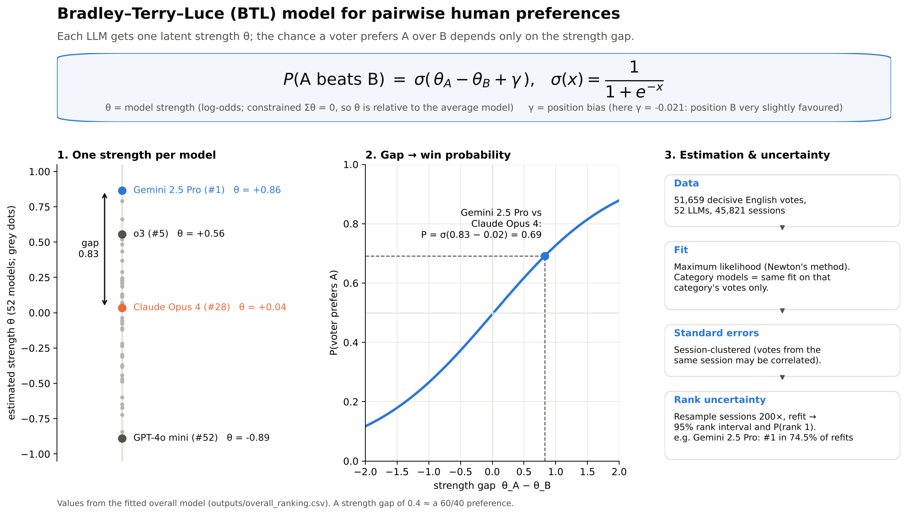

# Task-specific BTL rankings of LLMs from human preferences

Exploratory research project (UPenn MS in Data Science, proposed by Prof. Ying Jin) asking:

1. Can a Bradley–Terry–Luce (BTL) model rank LLMs from pairwise human preference votes?
2. How do rankings differ across math, coding and creative writing?
3. Do task-specific rankings predict held-out human preferences better than one overall ranking, and do they support more reliable task-specific recommendations?

**Findings are in [`05_research_summary.md`](05_research_summary.md).** In short: rankings shift
significantly by task; a partially pooled task-specific model predicts held-out votes slightly but
consistently better than the overall ranking; but the data cannot yet identify a better single
"best model" per task than the overall leader, because the top models are statistically tied.



## Data

`arena_research_data.csv` is a cleaned extract of
[`lmarena-ai/arena-human-preference-140k`](https://huggingface.co/datasets/lmarena-ai/arena-human-preference-140k)
(LMArena, licensed CC BY 4.0). It keeps one row per vote with the two model names, the winner,
the evaluation session id, the math / coding / creative-writing tags and the language. It contains
no prompts or model responses. `explore_data.py` rebuilds it from Hugging Face.

## Requirements

Python ≥ 3.10 with `numpy`, `pandas`, `scipy`, `matplotlib`
(tested with numpy 2.x, pandas 3.0.5, scipy 1.18.1, matplotlib 3.11.2).
`explore_data.py` additionally needs `datasets` (Hugging Face) to download the raw data.

## How to run

```bash
# 0. (only if you need to rebuild the cleaned CSV from Hugging Face)
python explore_data.py                 # writes arena_research_data.csv

# 1–5. full analysis, in order (~10 minutes on a laptop)
./run_all.sh                           # or run the scripts below one by one
```

| Order | Script | What it does | Runtime |
|---|---|---|---|
| 1 | `01_fit_overall.py` | Data checks, overall BTL, robust SEs, bootstrap rank intervals | ~2.5 min |
| 2 | `02_fit_categories.py` | Math / coding / creative-writing BTL fits, reliability flags, top models | ~5 min |
| 3 | `03_compare_rankings.py` | Rank changes, joint LR/Wald tests, null simulation, specialists, figures | ~1 min |
| 4 | `04_evaluate_predictions.py` | Grouped train/test + repeated grouped CV; overall vs category vs shrunk; recommendation evaluation | ~2 min |
| 5 | `04b_sensitivity.py` | Sensitivity analyses (ties, position, weights, overlap, sessions, language, sparsity, goodness of fit) | ~1 min |

Install dependencies with `pip install -r requirements.txt`. Each script prints a readable log; `run_all.sh` saves it to `outputs/log_*.txt`.
All randomness comes from `SEED` in `common.py`, so re-running reproduces every number.

## Files

| File | Role |
|---|---|
| `arena_research_data.csv` | Cleaned data (one row per vote; category flags; language; session id) |
| `common.py` | Shared settings: data path, English filter, categories, seed, bootstrap size, plotting style |
| `btl.py` | BTL library: data prep, graph diagnostics, Newton fit (`fit_btl`, generic `fit_logistic`), robust SEs, `diff_se`, `predict_proba` with explicit fallback, bootstrap ranks, metrics |
| `01_…04b_*.py` | Analysis steps (above) |
| `make_model_diagram.py` | Draws `outputs/figures/btl_model_diagram.png` (explanatory figure of the model) |
| `05_research_summary.md` | Final report |
| `outputs/*.csv` | All tables (listed at the end of the report) |
| `outputs/figures/*.png` | All figures |

## Changes made to the original code (Part A)

`btl.py` keeps the original function names and signatures (`prepare_decisive`, `model_counts`,
`comparison_graph`, `fit_btl`, `predict_proba`, `ranking_table`), so old code still runs. Changes:

1. **Solver:** exact Newton–Raphson in a sum-to-zero contrast parametrisation instead of L-BFGS
   with a 1e-8 ridge. The original stopped slightly early (θ off by ≤ 0.004; ranking unchanged).
2. **Covariance:** computed in the identified parametrisation instead of `pinv(H + 1e-8 I)`,
   which relied on cancelling a ~10⁸ variance in the unidentified direction.
3. **Session-clustered (sandwich) SEs** added (`se_robust`), plus `diff_se()` for pairwise tests.
4. **Weights, fractional outcomes (ties = 0.5) and offsets** supported (used for sensitivity
   analyses and partial pooling).
5. **`predict_proba` no longer silently assigns θ = 0** to unseen models; it raises an error
   unless an explicit `fallback` fit is given.
6. **Diagnostics:** strong-component labels, zero-win/zero-loss detection, convergence and
   condition-number reporting; **bootstrap rank intervals** (`bootstrap_ranks`, `rank_summary`).
7. `prepare_decisive` now stores `y` as float (needed for fractional outcomes); values unchanged.

`01_fit_overall.py` now also reports the robust SEs, Wald/LR tests for γ, the #1-vs-#2 test,
and the bootstrap rank intervals, and it writes `overall_fit_summary.csv`. The core output
`overall_ranking.csv` keeps all the original columns.

## Acknowledgements

Dataset: LMArena, `arena-human-preference-140k` (CC BY 4.0). All results were reproduced end to
end from these scripts.

## What is and is not verified

Everything in the report was produced by running these scripts end-to-end on the provided
`arena_research_data.csv`. Not verified: `explore_data.py` was not re-run (no internet
access to Hugging Face here). Its output (`research_results.txt`) is consistent with the CSV
(135,634 rows, 53 models).
